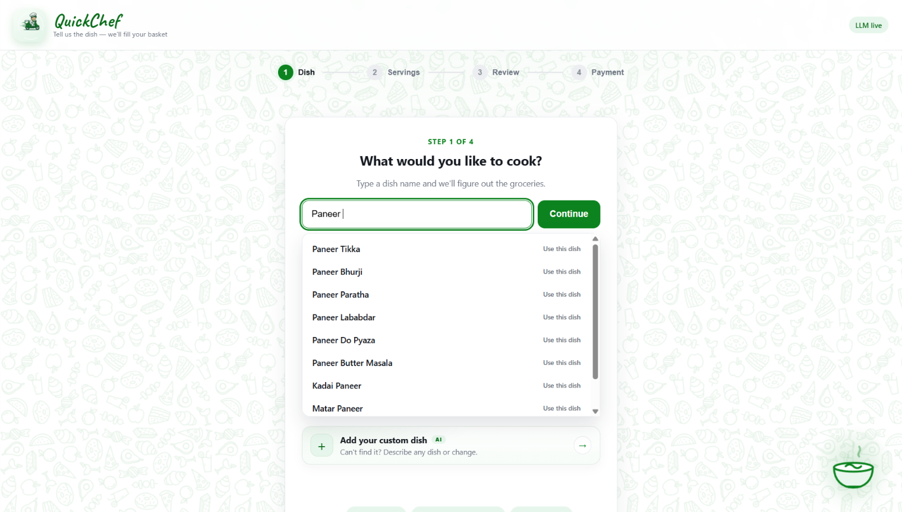
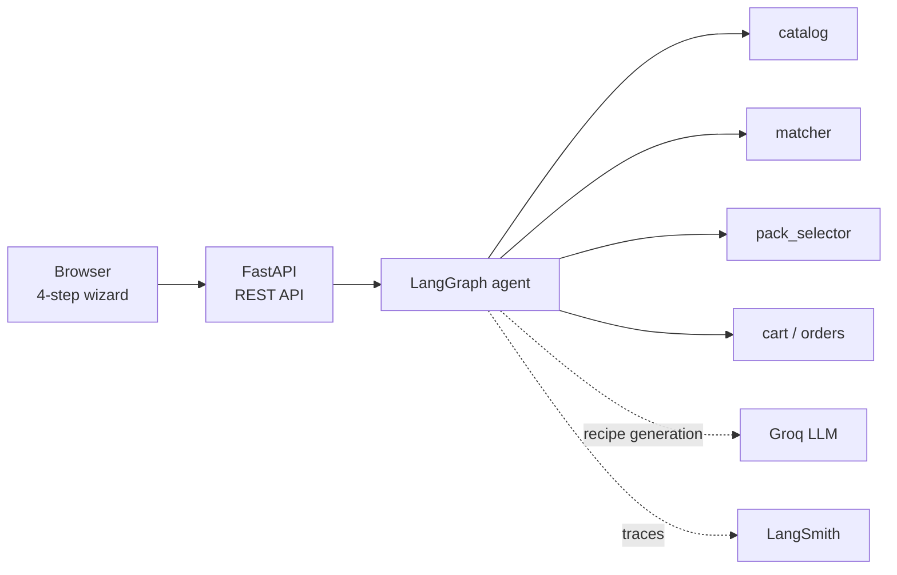
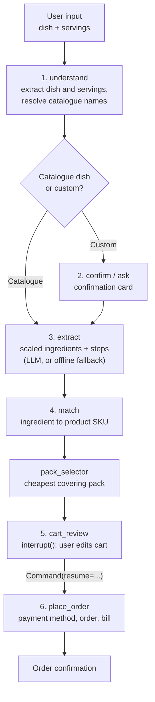

<div align="center">


# QuickChef

**Tell it what you want to cook. Get the recipe, the groceries, and a filled cart.**

An AI recipe-to-cart shopping agent for quick-commerce, built with FastAPI + LangGraph.

[](https://quickchef-qf47.onrender.com/)


[Live Demo](https://quickchef-qf47.onrender.com/) · [Screenshots](#-screenshots) · [How It Works](#-how-it-works) · [Quick Start](#-quick-start) · [REST API](#-rest-api) · [Testing](#-testing-and-evals) · [Docs](#-documentation)

</div>

---

## 🍽️ What is QuickChef?

Pick a dish, choose how many people you are cooking for, and QuickChef researches the recipe, scales every ingredient, converts them into **real grocery packs**, builds a cart, and lets you review everything before a mock payment.

```
Step 1  Dish      Type "dal makhni" or describe a custom dish
Step 2  Servings  Slider or typed input, e.g. 4 people
Step 3  Review    Full recipe + editable ingredient cards + live bill
Step 4  Payment   UPI / Card / COD -> order confirmation
```

> **The key idea:** the LLM decides the *recipe*; deterministic code decides *what to buy*. Every cart line maps to a real SKU and a cost-optimal pack, so the AI can never hallucinate a product.

## 🔗 Live Demo

**👉 https://quickchef-qf47.onrender.com/**

Try: `paneer`, `dal makhni`, or hit **Add your custom dish** and enter something like `Rajma without onion garlic`.

> ℹ️ Custom dishes use a global daily AI quota (see [Configuration](#-configuration)). If it is used up, catalogue dishes still work and the app tells you clearly instead of showing a misleading basket. The first load may also take a few seconds if the server is waking up.

## 📸 Screenshots

> Full screenshot gallery: [QuickChef screenshots & photos (Google Doc)](https://docs.google.com/document/d/15D0bhiHn1bFVCC2-5KOEDBd8VReeJGuO3uB0e6KNVGY/edit?tab=t.0)

| 1. Home Page | 2. Dish Selection | 
|:---:|:---:|
|  |  |

| 3. Review recipe & cart | 4. Add/Remove Iteam & Final confirmation |
|:---:|:---:|
|  |  |

<!-- Save your screenshots from the Google Doc into docs/screenshots/ using the file names above. -->

## ✨ Features

- **Four-step wizard** with a progress stepper, responsive layout, and keyboard support.
- **Live dish typeahead** over a curated catalogue. Multi-word searches use AND semantics (`malai chaap` → Malai Soy Chaap).
- **Catalogue-first resolution** with LLM-assisted ambiguity handling. `Matar Kulcha` can suggest `Chole Kulche`, and learned corrections short-circuit future calls.
- **AI custom dishes** with natural-language modifications, scaled ingredients, and cooking steps.
- **Deterministic cart building**: ingredient-to-SKU matching, alias handling, fuzzy names, pantry exclusion, and cost-optimal whole-pack selection.
- **Human-in-the-loop review** using LangGraph `interrupt()` / `Command(resume=...)`: add, remove, or change quantities before paying.
- **Offline fallback recipes** for common dishes when no API key is configured.
- **Global daily AI quota** (default 6 logical LLM requests, resets at midnight `Asia/Kolkata`) with a friendly HTTP 429 message.
- **Mock payments** (UPI / Card / COD) and an order confirmation screen.
- **Feedback capture** for dish rejections, accepted corrections, and review likes/dislikes, saved to a local JSONL queue for manual promotion into the golden dataset.
- **Golden dataset + evals**: 77 curated cases, deterministic offline mode, live mode, JSON baselines, and a pytest gate.
- **LangSmith tracing** for graph runs and LLM calls.
- **Accessible motion**: food-doodle background and animations that respect `prefers-reduced-motion`.

## 🧠 How It Works

### Architecture



### Flow of data



1. **understand** – extract `dish` and `servings`; resolve catalogue names and offer candidates for ambiguous input. The custom path keeps the user's wording so modifications survive.
2. **confirm / ask** – catalogue picks advance immediately; custom dishes wait for the confirmation card. Missing input is prompted.
3. **extract** – generate scaled ingredients and cooking steps with the LLM, or use an offline fallback for a plain catalogue dish. Custom dishes are **LLM-only**.
4. **match** – resolve each ingredient to a product SKU and choose the cheapest covering pack.
5. **cart_review** – pause with LangGraph `interrupt()` so the user can edit the cart.
6. **place_order** – record the payment method, create the order, emit a bill, and clear the cart.

### Custom dishes

For anything outside the quick picks, especially modifications:

- **Exclusions:** `Rajma without onion garlic`, `Paneer butter masala no cream`
- **Additions:** `Mix veg with mushrooms`, `Chole extra paneer`
- **New dishes:** `Misal Pav`, `Bengali-style fish curry`

If the API key is missing, the API returns **422** with an AI-chef message. If the daily quota is exhausted and no cached LLM recipe exists, it returns **429**. QuickChef never silently substitutes an unmodified offline recipe for a custom dish. Catalogue picks, cached LLM recipes, and plain offline recipes are quota-free.

## 🚀 Quick Start

**Requirements:** Python **3.11+** and, optionally, a [Groq](https://console.groq.com/) API key for live AI.

```bash
git clone https://github.com/AyushNeedsCaffeine/QuickChef.git
cd QuickChef

python -m venv .venv
source .venv/bin/activate        # Windows: .venv\Scripts\activate
pip install -r requirements.txt

# Optional: enable the AI chef and live recipe research
cp .env.example .env
# edit .env and set GROQ_API_KEY=...
```

Run the app:

```bash
uvicorn app.main:app --reload --port 8000
```

Open <http://127.0.0.1:8000>.

> Without `GROQ_API_KEY`, QuickChef runs in **offline recipe mode**: catalogue dishes with fallback recipes still work, but custom dishes and modifications need the AI chef.

### Five-minute walkthrough

1. Type `paneer` or `chaap` and pick a live suggestion.
2. Set servings to `4`; QuickChef scales the recipe and fills the cart.
3. Review the full recipe and adjust ingredient quantities.
4. Choose UPI and pay; the confirmation shows the order id.

## ⚙️ Configuration

Copy `.env.example` to `.env`. The most useful settings:

| Variable | Default | Purpose |
|---|---|---|
| `GROQ_API_KEY` | *(empty)* | Enables the AI chef when set |
| `GROQ_MODEL` | `openai/gpt-oss-120b` | Groq model id |
| `LLM_DAILY_LIMIT` | `6` | Global logical LLM requests per day; `0` disables the limit |
| `LLM_QUOTA_TIMEZONE` | `Asia/Kolkata` | Timezone for the daily reset |
| `PHOTO_ENABLED` | `true` | Wikimedia custom-dish photos |
| `FEEDBACK_ENABLED` | `true` | Capture feedback for golden-dataset review |
| `DELIVERY_FEE` / `FREE_DELIVERY_ABOVE` / `HANDLING_FEE` | `25` / `199` / `9` | Bill settings in INR |
| `LANGSMITH_TRACING` | `false` | Enable LangSmith tracing |

<details>
<summary>All variables</summary>

| Variable | Default | Purpose |
|---|---|---|
| `GROQ_REASONING_EFFORT` | `low` | Keeps dish/recipe extraction fast |
| `GROQ_TIMEOUT` | `30` | Per-request timeout in seconds |
| `GROQ_MAX_TOKENS` | `1200` | Max completion tokens |
| `GROQ_MAX_RETRIES` | `1` | Provider retries for transient errors |
| `LLM_QUOTA_PATH` | `data/llm_quota.json` | File-backed quota counter |
| `PHOTO_TIMEOUT` | `4` | Photo network timeout in seconds |
| `PHOTO_CACHE_TTL` | `3600` | Successful photo cache TTL |
| `PHOTO_FAILURE_TTL` | `600` | Retry window after a failed lookup |
| `PHOTO_USER_AGENT` | QuickChef + contact | Descriptive Wikimedia User-Agent |
| `FEEDBACK_PATH` | `evals/golden/feedback.jsonl` | Append-only feedback queue |
| `LANGSMITH_API_KEY` | *(empty)* | LangSmith key |
| `LANGSMITH_PROJECT` | `quickchef` | LangSmith project name |
| `LANGSMITH_ENDPOINT` | `https://api.smith.langchain.com` | LangSmith endpoint |

</details>

**Quota:** one unit is consumed per logical LLM call (provider retries are free). The counter is global to the deployment. On exhaustion the API returns HTTP 429: *"Oops! The AI chef has used today's free AI quota. Please try again tomorrow, or pick a dish from the catalogue."*

## 🔌 REST API

| Method | Path | Description |
|---|---|---|
| `POST` | `/api/session` | Create a session |
| `GET` | `/api/session/{session_id}` | Session state: dish, servings, recipe, cart, pause state |
| `GET` | `/api/dish/suggest?q=&limit=` | Deterministic catalogue typeahead |
| `POST` | `/api/dish/{session_id}` | Step 1: resolve `{dish, custom?}` |
| `GET` | `/api/dish/photo?dish=` | Optional custom-dish photo lookup |
| `POST` | `/api/synonyms` | Learn a correction `{term, canonical}` |
| `POST` | `/api/feedback/{session_id}` | Capture dish/review feedback |
| `POST` | `/api/servings/{session_id}` | Step 2: build recipe + cart |
| `POST` | `/api/chat/{session_id}` | Conversational agent entry point |
| `GET` | `/api/cart/{session_id}` | Cart items and totals |
| `POST` | `/api/cart/{session_id}/items` | Add a product |
| `PATCH` | `/api/cart/{session_id}/items/{product_id}` | Set quantity |
| `DELETE` | `/api/cart/{session_id}/items/{product_id}` | Remove a product |
| `POST` | `/api/order/{session_id}/pay` | Step 4: mock payment + place order |
| `POST` | `/api/cart/{session_id}/confirm` | Confirm and place order |
| `POST` | `/api/cart/{session_id}/cancel` | Cancel a pending order |
| `GET` | `/api/orders/{session_id}` | Session orders |
| `GET` | `/api/catalog/search?q=` | Search the product catalogue |
| `GET` | `/api/health` | Health, LLM, tracing, and quota status |

<details>
<summary>Example: order a catalogue dish with curl</summary>

```bash
BASE=http://127.0.0.1:8000
SID=$(curl -s -X POST $BASE/api/session | python3 -c "import sys,json;print(json.load(sys.stdin)['session_id'])")

curl -s -X POST $BASE/api/dish/$SID \
  -H 'Content-Type: application/json' \
  -d '{"dish":"dal makhni"}'

curl -s -X POST $BASE/api/servings/$SID \
  -H 'Content-Type: application/json' \
  -d '{"dish":"Dal Makhani","servings":4}'

curl -s $BASE/api/cart/$SID | python3 -m json.tool

curl -s -X POST $BASE/api/order/$SID/pay \
  -H 'Content-Type: application/json' \
  -d '{"method":"upi","address":"Home"}' | python3 -m json.tool
```

</details>

<details>
<summary>Example: custom dish</summary>

```bash
curl -s -X POST $BASE/api/dish/$SID \
  -H 'Content-Type: application/json' \
  -d '{"dish":"rajma without onion garlic","custom":true}'

curl -s -X POST $BASE/api/servings/$SID \
  -H 'Content-Type: application/json' \
  -d '{"dish":"Rajma without onion garlic","servings":4,"custom":true}'
```

</details>

## 🧪 Testing and Evals

```bash
pytest -q                         # unit/API tests + deterministic offline golden gate
python -m evals.run_golden        # offline golden run (no key, no network)
python -m evals.run_golden --live # live LLM + photo cases (needs GROQ_API_KEY)
python -m evals.run_evals         # LangSmith dataset + rule-based resolver scoring
```

- **77 golden cases**, with a CI-safe offline mode (no key, no network).
- Tests isolate the daily quota in a temp file and disable the LLM.
- Committed baselines live in `evals/baselines/`; the runner clears caches per case so local state cannot leak into results.

<details>
<summary>Feedback → golden cases</summary>

The UI captures dish rejections, accepted corrections, and review likes/dislikes without blocking the order flow. Promotion into the golden set is **manual**, so bad AI judgments never become expectations automatically.

```bash
python -m evals.promote_feedback --summary
python -m evals.promote_feedback --list
python -m evals.promote_feedback --id fb_abc123 --expect-display "Chole Kulche" --out /tmp/case.json
python -m evals.run_feedback --kind dish_rejected --offline
```

</details>

## 🔭 Observability

Enable LangSmith tracing in `.env`:

```bash
LANGSMITH_TRACING=true
LANGSMITH_API_KEY=ls__...
LANGSMITH_PROJECT=quickchef
```

Each graph run is tagged by wizard stage with `session_id`, `dish`, and `servings` metadata. `GET /api/health` reports whether tracing and the AI chef are enabled.

## 📁 Project Structure

```
QuickChef/
├── app/
│   ├── config.py              # env-driven settings
│   ├── models.py              # Pydantic request/response models
│   ├── main.py                # FastAPI app + REST endpoints
│   ├── agent/
│   │   ├── graph.py           # LangGraph state machine + HITL + quota/cache rules
│   │   ├── state.py           # AgentState
│   │   ├── prompts.py         # LLM prompts
│   │   └── recipes.py         # catalogue helpers + offline recipes/steps
│   └── services/
│       ├── catalog.py         # product catalog + name resolution
│       ├── matcher.py         # ingredient -> SKU
│       ├── pack_selector.py   # cost-optimal pack choice
│       ├── cart.py            # in-memory cart + orders
│       ├── photos.py          # optional custom-dish photo gate + cache
│       ├── feedback.py        # append-only feedback queue
│       ├── llm_quota.py       # file-backed global daily quota
│       └── synonyms.py        # learned dish-name corrections
├── evals/                     # golden dataset, baselines, runners
├── data/catalog.json          # mock product catalogue
├── templates/index.html
├── static/                    # css, js, logo, favicon
├── tests/                     # pytest suite
└── docs/{SRS,HLD,LLD}.md
```

## ⚠️ Scope and Limitations

- Mock in-memory catalogue, cart, and orders; restarting clears sessions.
- Mock payment only; no real gateway or Blinkit/Zepto integration.
- Recipe quality depends on the LLM. The offline corpus covers a limited set of dishes and cannot apply modifications.
- Custom dishes require the AI chef (422 without a key, 429 when the quota is exhausted).
- Some catalogue dishes (e.g. Paneer Tikka, Kala Chana, Pumpkin Sabzi, Maggi Noodles) have no offline fallback and also need the AI chef.
- Custom photos are best-effort Wikimedia matches, rejected for people, decoration, weak relevance, low resolution, or extreme aspect ratios.
- Learned synonyms and feedback are local files with no review UI yet; use the promotion CLI.
- The UI is verified manually in a browser; there is no browser-automation suite.

## 🗺️ Roadmap

- [ ] Real quick-commerce integration (catalogue + live pricing)
- [ ] Real payment gateway
- [ ] Persistent database for sessions, carts, and orders
- [ ] Review UI for learned synonyms and feedback
- [ ] Browser-automation test suite

## 📚 Documentation

- [`docs/SRS.md`](docs/SRS.md) – Software Requirements Specification
- [`docs/HLD.md`](docs/HLD.md) – High-Level Design
- [`docs/LLD.md`](docs/LLD.md) – Low-Level Design

---

<div align="center">

### 👨‍💻 Built by Ayush

B.Tech IT student at MAIT, GGSIPU, Delhi — building with LLMs, agents, and RAG.

[](https://github.com/AyushNeedsCaffeine)
[](https://www.linkedin.com/in/YOUR-LINKEDIN-HANDLE)

If QuickChef saved you a trip to the grocery aisle, drop a ⭐ on the repo!

*Made with ☕, Python, and a lot of paneer.*

</div>