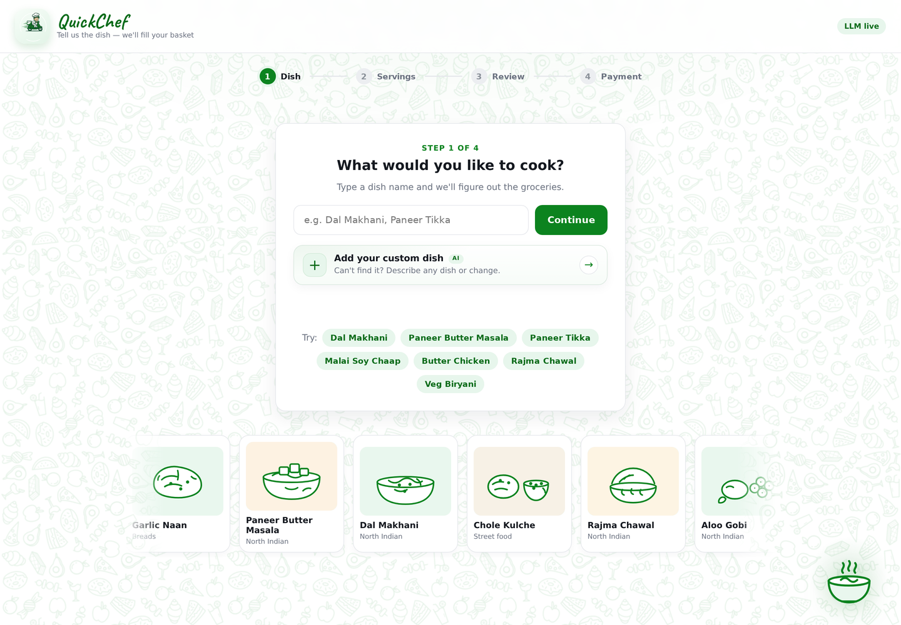
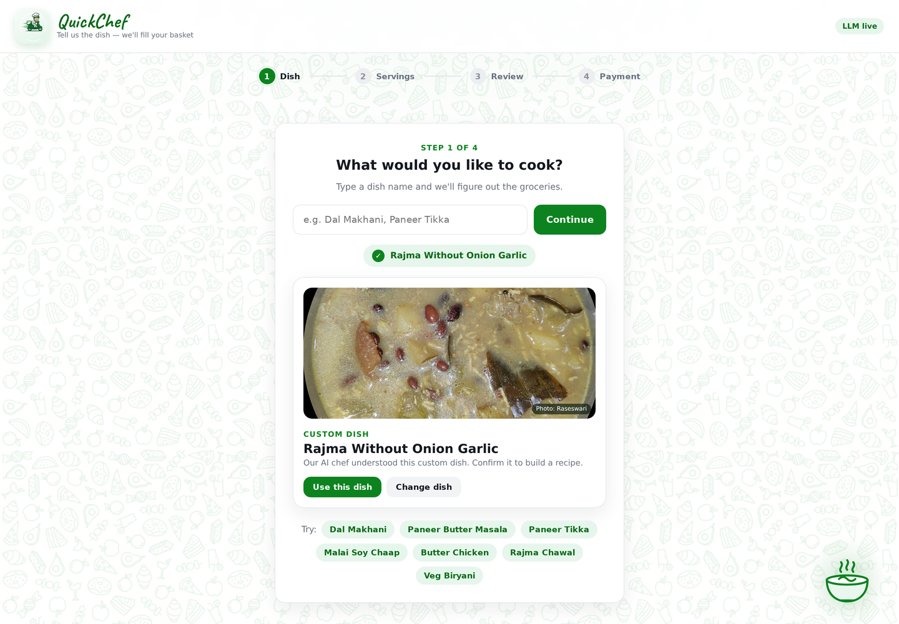
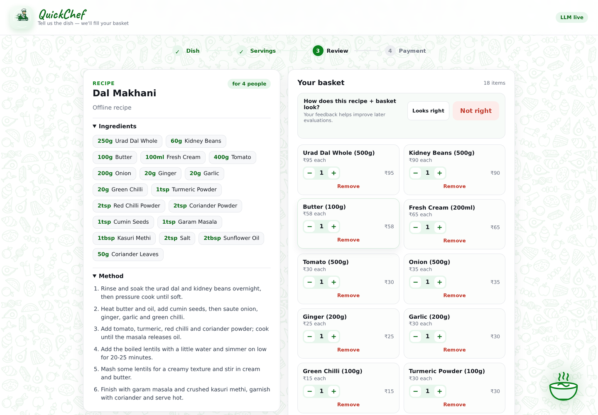
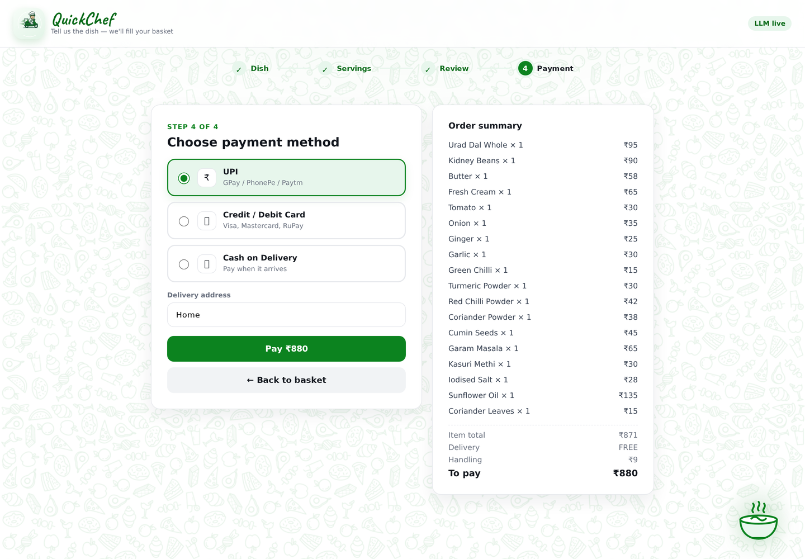

<p align="center">
  
</p>

<h1 align="center">QuickChef</h1>

<p align="center">
  <strong>Tell it what you want to cook. Get the recipe, the groceries, and a filled cart.</strong>
</p>

<p align="center">
  <a href="#quick-start">Quick start</a> ·
  <a href="#screenshots">Screenshots</a> ·
  <a href="#custom-dishes">Custom dishes</a> ·
  <a href="#how-it-works">How it works</a> ·
  <a href="#rest-api">REST API</a> ·
  <a href="#testing-and-evals">Testing</a> ·
  <a href="#documentation">Docs</a>
</p>

---

QuickChef is a recipe-to-cart shopping agent for quick-commerce. Pick a dish, choose how many
people you are cooking for, and it researches the recipe, scales every ingredient, converts them
into real grocery packs, builds a cart, and lets you review everything before a mock payment.

```text
Step 1  Dish      Type "dal makhni" or describe a custom dish
Step 2  Servings  Slider or typed input, e.g. 4 people
Step 3  Review    Full recipe + editable ingredient cards + live bill
Step 4  Payment   UPI / Card / COD -> order confirmation
```

## Screenshots

| Dish selection | Custom dish |
|:---:|:---:|
| [](docs/screenshots/step-1-dish.png) | [](docs/screenshots/custom-dish.png) |
| **Recipe + basket review** | **Payment** |
| [](docs/screenshots/review.png) | [](docs/screenshots/payment.png) |

## v2.3.0 highlights

- **Custom dishes are first-class.** A new page-1 card opens the custom-dish flow, so
  `Rajma without onion garlic` or a completely new dish is an explicit action instead of a
  hidden fallback.
- **Custom recipes are AI-backed.** Custom dishes never silently use an unmodified offline base
  recipe. If the AI chef is unavailable or the daily quota is exhausted, QuickChef explains why
  instead of showing a misleading basket.
- **Quota-safe caching.** Offline fallbacks created because the AI quota was exhausted are not
  cached, and cached offline recipes are ignored for custom/modified requests. A quota reset or
  restart cannot resurrect a stale unmodified recipe.
- **Cleaner quick picks.** Modifier presets such as `Rajma without onion garlic` and
  `Mix Veg + Mushrooms` were removed from the normal menu; modifications now live in the custom
  dish flow.
- **v2.2 payment fix retained.** The payment button reliably re-enables after a successful order
  or **Start a new order**.

## Features

- **Four-step wizard** with a progress stepper, responsive layout, and keyboard support.
- **Live dish typeahead** over a curated catalogue. Multi-word searches use AND semantics
  (`malai chaap` -> Malai Soy Chaap); unknown names are rejected cleanly.
- **Catalogue-first resolution** with LLM-assisted ambiguity handling. `Matar Kulcha` can suggest
  `Chole Kulche`, while learned corrections short-circuit future calls.
- **AI custom dishes** with natural-language modifications, scaled ingredients, and cooking steps.
- **Deterministic cart building** after recipe generation: ingredient-to-SKU matching, alias
  handling, fuzzy names, pantry exclusion, and cost-optimal whole-pack selection.
- **Human-in-the-loop review** with LangGraph `interrupt()` / `Command(resume=...)`; add, remove,
  or change cart quantities before paying.
- **Optional custom-dish photos** from Wikimedia, shown only on the custom confirmation card and
  only after relevance and quality checks.
- **Offline fallback recipes** for common dishes when no API key is configured.
- **Global daily AI quota** (`6` logical LLM requests by default, reset at midnight
  `Asia/Kolkata`), with a friendly HTTP 429 message. Set `LLM_DAILY_LIMIT=0` to disable it.
- **Mock payment methods** (UPI / Card / COD) and an order confirmation screen.
- **Feedback capture** for dish rejections, accepted corrections, and review likes/dislikes,
  written to a local JSONL queue for manual golden-dataset promotion.
- **Golden dataset + evals**: 77 curated cases, deterministic offline mode, live mode, JSON
  baselines, and a pytest gate.
- **LangSmith tracing** for graph runs and LLM calls when enabled.
- **Manual-friendly UI**: food-doodle background, dish marquee, steaming-bowl doodle, and motion
  that respects `prefers-reduced-motion`.

## Quick start

Requirements: Python **3.11+** (tested on 3.14) and, optionally, a Groq API key for live AI.

```bash
python -m venv .venv
source .venv/bin/activate        # Windows: .venv\Scripts\activate
pip install -r requirements.txt

# Optional: enable the AI chef and live recipe research
cp .env.example .env
# edit .env and set GROQ_API_KEY=...
```

Run the app:

```bash
uvicorn app.main:app --reload --port 8000
```

Open <http://127.0.0.1:8000>.

Without `GROQ_API_KEY`, QuickChef runs in **offline recipe mode**: catalogue dishes with fallback
recipes still work, but custom dishes and modifications require the AI chef.

### Five-minute walkthrough

1. Type `paneer` or `chaap` and pick a live suggestion.
2. Set servings to `4`; QuickChef scales the recipe and fills the cart.
3. Review the full recipe and adjust ingredient quantities.
4. Choose UPI and pay; the confirmation shows the order id.

For a custom dish:

1. Click **Add your custom dish** under the dish search.
2. Enter `Rajma without onion garlic` and submit.
3. Confirm the dish, choose servings, and review the AI-generated recipe.

## Custom dishes

Custom dishes are for anything outside the curated quick picks, especially modifications:

- Exclusions: `Rajma without onion garlic`, `Paneer butter masala no cream`
- Additions: `Mix veg with mushrooms`, `Chole extra paneer`
- New dishes: `Misal Pav`, `Bengali-style fish curry`

The flow is intentionally explicit:

1. **Add your custom dish** opens the custom input.
2. The AI chef resolves the dish and, when needed, asks for confirmation.
3. The recipe comes from the LLM; the order is still built by deterministic catalogue matching, so
   every cart line has a real SKU and pack price.
4. If the key is missing, the API returns **422** with an AI-chef message.
5. If the daily quota is exhausted and no cached LLM recipe exists, the API returns **429** with the
   quota message. QuickChef does not substitute an unmodified offline recipe for a custom dish.

Custom requests consume the daily quota. Catalogue-only picks, cached LLM recipes, and plain
offline recipes are quota-free.

## How it works

```text
Browser (4-step wizard)
        |
        v
FastAPI  --->  LangGraph agent  --->  catalog
                              |---->  matcher
                              |---->  pack_selector
                              '---->  cart / orders
```

1. **understand**: extract `dish` and `servings`; resolve catalogue names and offer candidates for
   ambiguous input. The custom path keeps the user's wording so modifications survive.
2. **confirm / ask**: catalogue selections advance immediately; custom dishes wait for the
   confirmation card. Missing input is prompted.
3. **extract**: generate scaled ingredients and cooking steps using the LLM, or an offline fallback
   for a plain catalogue dish. Custom dishes are LLM-only.
4. **match**: resolve each ingredient to a product SKU and choose the cheapest covering pack.
5. **cart_review**: pause with LangGraph `interrupt()` so the user can edit the cart.
6. **place_order**: record the payment method, create the order, emit a bill, and clear the cart.

The cart step is deliberately deterministic. The LLM decides the recipe; the matcher and pack
selector decide which real products to buy.

## Project structure

```text
QuickChef/
├── app/
│   ├── config.py              # env-driven settings
│   ├── models.py              # Pydantic request/response models
│   ├── main.py                # FastAPI app + REST endpoints
│   ├── agent/
│   │   ├── graph.py           # LangGraph state machine + HITL + quota/cache rules
│   │   ├── state.py           # AgentState
│   │   ├── prompts.py         # LLM prompts
│   │   └── recipes.py         # catalogue helpers + offline recipes/steps
│   └── services/
│       ├── catalog.py         # product catalog + name resolution
│       ├── matcher.py         # ingredient -> SKU
│       ├── pack_selector.py   # cost-optimal pack choice
│       ├── cart.py            # in-memory cart + orders
│       ├── photos.py          # optional custom-dish photo gate + cache
│       ├── feedback.py        # append-only feedback queue
│       ├── llm_quota.py       # file-backed global daily quota
│       └── synonyms.py        # learned dish-name corrections
├── evals/
│   ├── golden/                # cases.jsonl, manifest, schema
│   ├── baselines/             # committed offline/live result baselines
│   ├── golden_feedback.py     # feedback queue loader
│   ├── promote_feedback.py    # review/promote feedback into golden cases
│   ├── run_feedback.py        # replay captured dish feedback
│   ├── run_evals.py           # LangSmith experiment runner
│   └── run_golden.py          # deterministic/live golden runner
├── data/catalog.json          # mock product catalogue
├── data/synonyms.json         # learned corrections (runtime, gitignored)
├── data/llm_quota.json        # daily LLM counter (runtime, gitignored)
├── templates/index.html
├── static/{style.css,script.js,logo*.png,favicon.png,...}
├── static/dish_photos/        # custom-photo cache (runtime, gitignored)
├── tests/                     # pytest suite
└── docs/{SRS,HLD,LLD}.md
```

## Configuration

Copy `.env.example` to `.env` and set what you need.

| Variable | Default | Purpose |
|---|---|---|
| `GROQ_API_KEY` | _(empty)_ | Enables the AI chef when set |
| `GROQ_MODEL` | `openai/gpt-oss-120b` | Groq model id |
| `GROQ_REASONING_EFFORT` | `low` | Keeps dish/recipe extraction fast |
| `GROQ_TIMEOUT` | `30` | Per-request timeout in seconds |
| `GROQ_MAX_TOKENS` | `1200` | Max completion tokens |
| `GROQ_MAX_RETRIES` | `1` | Provider retries for transient errors |
| `LLM_DAILY_LIMIT` | `6` | Global logical LLM requests per day; `0` disables |
| `LLM_QUOTA_TIMEZONE` | `Asia/Kolkata` | Timezone for the daily reset |
| `LLM_QUOTA_PATH` | `data/llm_quota.json` | File-backed quota counter |
| `PHOTO_ENABLED` | `true` | Enable Wikimedia custom-dish photos |
| `PHOTO_TIMEOUT` | `4` | Photo network timeout in seconds |
| `PHOTO_CACHE_TTL` | `3600` | Successful photo cache TTL |
| `PHOTO_FAILURE_TTL` | `600` | Retry window after a failed lookup |
| `PHOTO_USER_AGENT` | QuickChef + contact | Descriptive Wikimedia User-Agent |
| `FEEDBACK_ENABLED` | `true` | Capture feedback for golden-dataset review |
| `FEEDBACK_PATH` | `evals/golden/feedback.jsonl` | Append-only feedback queue |
| `DELIVERY_FEE` | `25` | Delivery fee in INR |
| `FREE_DELIVERY_ABOVE` | `199` | Free-delivery threshold in INR |
| `HANDLING_FEE` | `9` | Handling fee in INR |
| `LANGSMITH_TRACING` | `false` | Enable LangSmith tracing |
| `LANGSMITH_API_KEY` | _(empty)_ | LangSmith key |
| `LANGSMITH_PROJECT` | `quickchef` | LangSmith project name |
| `LANGSMITH_ENDPOINT` | `https://api.smith.langchain.com` | LangSmith endpoint |

Quota details:

- One quota unit is consumed per logical LLM call. Provider retries inside that call are free.
- The counter is global to the deployment and stored in `LLM_QUOTA_PATH`.
- Reset is at midnight in `LLM_QUOTA_TIMEZONE`.
- Quota exhaustion returns HTTP 429 with:
  `Oops! The AI chef has used today's free AI quota. Please try again tomorrow, or pick a dish from the catalogue.`

## REST API

| Method | Path | Description |
|---|---|---|
| `POST` | `/api/session` | Create a session |
| `GET` | `/api/session/{session_id}` | Session state: dish, servings, recipe, cart, pause state |
| `GET` | `/api/dish/suggest?q=&limit=` | Deterministic catalogue typeahead |
| `POST` | `/api/dish/{session_id}` | Step 1: resolve `{dish, custom?}`; custom dishes require AI |
| `GET` | `/api/dish/photo?dish=` | Optional custom-dish photo lookup |
| `POST` | `/api/synonyms` | Learn a correction `{term, canonical}` |
| `POST` | `/api/feedback/{session_id}` | Capture dish/review feedback |
| `POST` | `/api/servings/{session_id}` | Step 2: build recipe + cart from `{dish, servings, custom?}` |
| `POST` | `/api/chat/{session_id}` | Conversational agent entry point |
| `GET` | `/api/cart/{session_id}` | Cart items and totals |
| `POST` | `/api/cart/{session_id}/items` | Add a product |
| `PATCH` | `/api/cart/{session_id}/items/{product_id}` | Set quantity |
| `DELETE` | `/api/cart/{session_id}/items/{product_id}` | Remove a product |
| `POST` | `/api/order/{session_id}/pay` | Step 4: mock payment + place order |
| `POST` | `/api/cart/{session_id}/confirm` | Confirm and place order |
| `POST` | `/api/cart/{session_id}/cancel` | Cancel a pending order |
| `GET` | `/api/orders/{session_id}` | Session orders |
| `GET` | `/api/catalog/search?q=` | Search the product catalogue |
| `GET` | `/api/health` | Health, LLM, tracing, and quota status |

### Example: catalogue dish

```bash
BASE=http://127.0.0.1:8000
SID=$(curl -s -X POST $BASE/api/session | python3 -c "import sys,json;print(json.load(sys.stdin)['session_id'])")

curl -s -X POST $BASE/api/dish/$SID \
  -H 'Content-Type: application/json' \
  -d '{"dish":"dal makhni"}'

curl -s -X POST $BASE/api/servings/$SID \
  -H 'Content-Type: application/json' \
  -d '{"dish":"Dal Makhani","servings":4}'

curl -s $BASE/api/cart/$SID | python3 -m json.tool

curl -s -X POST $BASE/api/order/$SID/pay \
  -H 'Content-Type: application/json' \
  -d '{"method":"upi","address":"Home"}' | python3 -m json.tool
```

### Example: custom dish

```bash
curl -s -X POST $BASE/api/dish/$SID \
  -H 'Content-Type: application/json' \
  -d '{"dish":"rajma without onion garlic","custom":true}'

curl -s -X POST $BASE/api/servings/$SID \
  -H 'Content-Type: application/json' \
  -d '{"dish":"Rajma without onion garlic","servings":4,"custom":true}'
```

## Testing and evals

```bash
pytest -q
python -m evals.run_golden
python -m evals.run_golden --live
```

- **pytest** runs unit/API tests and the deterministic offline golden gate. Tests isolate the daily
  quota in a temporary file and disable the LLM.
- **Offline golden** is the CI-safe mode: no key, no network, all 44 offline cases must pass.
- **Live golden** exercises LLM and photo cases and needs `GROQ_API_KEY` plus network access.
- **LangSmith evals** create a dataset and score the resolver with rule-based checks:

```bash
python -m evals.run_evals
```

Focused golden runs and baselines:

```bash
python -m evals.run_golden --suite dish --suite recipe
python -m evals.run_golden --live --suite flow
python -m evals.run_golden --write-baseline evals/baselines/offline.json
```

Committed baselines live in `evals/baselines/`. The runner isolates synonym/photo state and clears
the recipe cache per case, so local caches cannot leak into results.

### Feedback to golden cases

The UI captures dish rejections, accepted corrections, and review likes/dislikes without blocking
the order flow. Raw events are written to `evals/golden/feedback.jsonl` (gitignored). Promotion is
manual so bad AI judgments never become expectations automatically:

```bash
python -m evals.promote_feedback --summary
python -m evals.promote_feedback --list
python -m evals.promote_feedback --id fb_abc123 --expect-display "Chole Kulche" --out /tmp/case.json
python -m evals.promote_feedback --id fb_def456 --suite recipe \
  --expect-json '{"must_include": [["rajma", "kidney"]], "min_steps": 3}' --append
python -m evals.run_feedback --kind dish_rejected --offline
```

## Observability

Enable LangSmith tracing in `.env`:

```bash
LANGSMITH_TRACING=true
LANGSMITH_API_KEY=ls__...
LANGSMITH_PROJECT=quickchef
# EU accounts:
# LANGSMITH_ENDPOINT=https://eu.api.smith.langchain.com
```

Each graph run is named and tagged by wizard stage and includes `session_id`, `dish`, and
`servings` metadata. `GET /api/health` reports whether tracing and the AI chef are enabled.

## Scope and limitations

- Mock in-memory catalogue, cart, and orders; restarting clears sessions.
- Mock payment only; no real gateway or Blinkit/Zepto integration.
- Recipe quality depends on the LLM. The offline corpus covers a limited set of dishes and cannot
  apply modifications.
- Custom dishes require the AI chef. Without a key the API returns 422; with the quota exhausted it
  returns 429 instead of an unmodified fallback recipe.
- Catalogue dishes with no fallback (for example Paneer Tikka, Kala Chana, Pumpkin Sabzi, and Maggi
  Noodles) also require the AI chef.
- Custom photos are best-effort Wikimedia matches, cached with attribution and rejected for people,
  decoration, weak relevance, low resolution, or extreme aspect ratios.
- Learned synonyms live in gitignored `data/synonyms.json`; there is no review UI yet.
- Feedback is local JSONL and has no review UI; use the promotion CLI.
- The UI is responsive but verified manually in a browser; there is no browser-automation suite.

## Documentation

- [`docs/SRS.md`](docs/SRS.md) - Software Requirements Specification
- [`docs/HLD.md`](docs/HLD.md) - High-Level Design
- [`docs/LLD.md`](docs/LLD.md) - Low-Level Design
