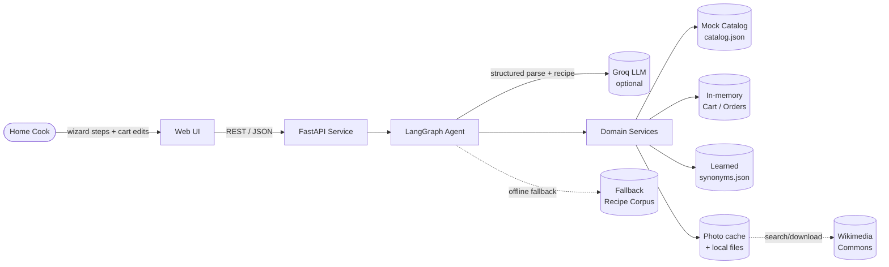
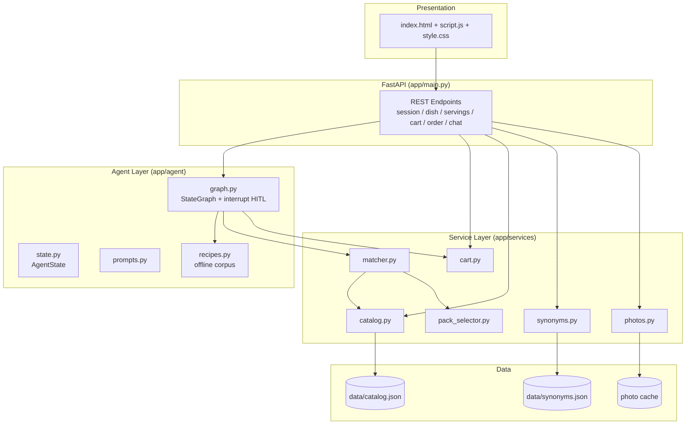
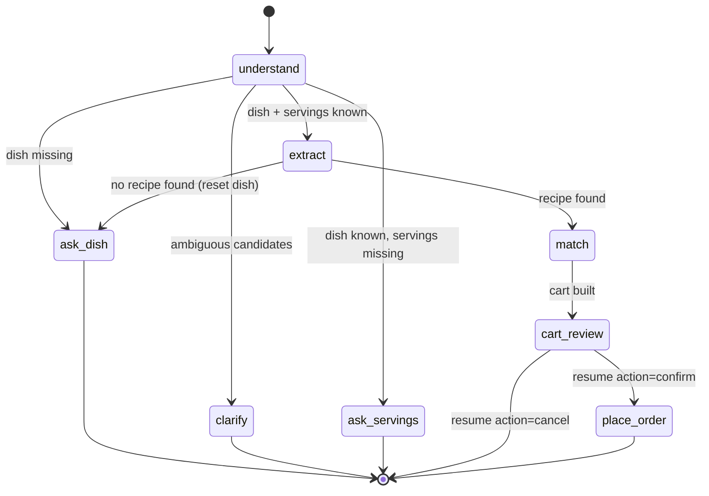
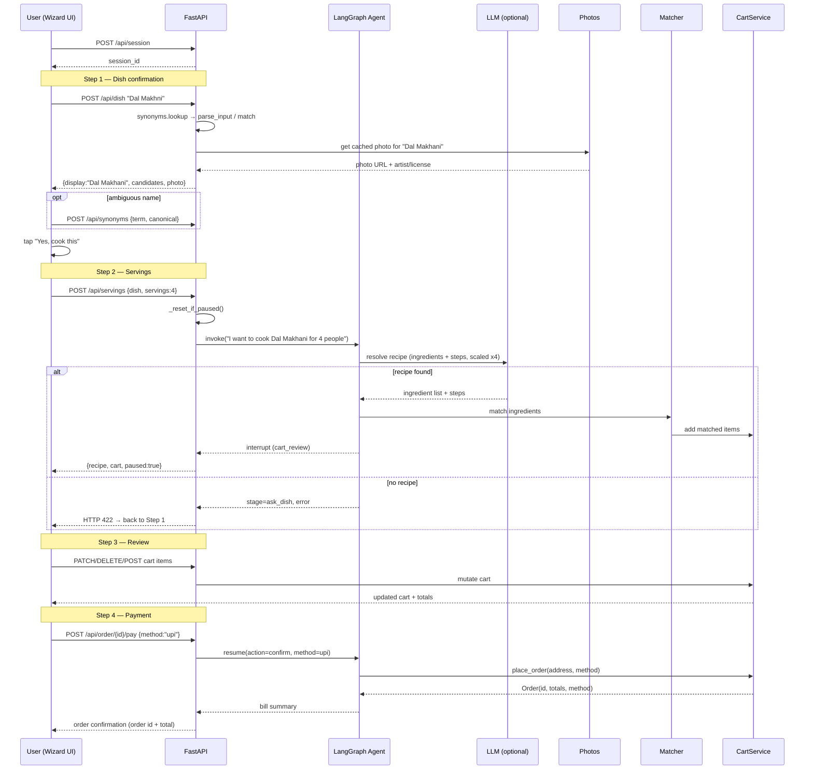
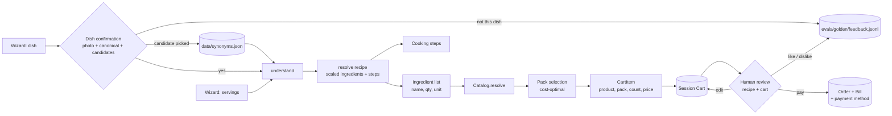
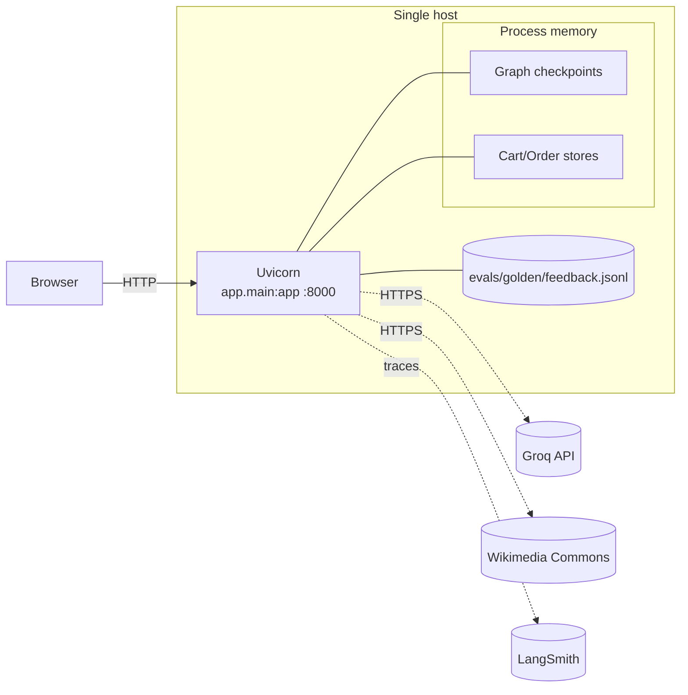

# High-Level Design (HLD)

**Project:** QuickChef — Recipe-to-Cart Shopping Agent
**Version:** 1.0
**Companion documents:** [SRS](./SRS.md), [LLD](./LLD.md)

---

## 1. Overview

QuickChef is a two-tier web application:

1. **Presentation tier** — a browser UI (4-step wizard: dish → servings → review → payment) served by the backend.
2. **Application tier** — a FastAPI service that exposes REST endpoints and hosts a
   LangGraph agent (the "brain") plus supporting services (catalog, matcher, pack selector, cart).

The agent performs recipe research (ingredients + cooking steps) and cart building; the cart is then handed to a
**human-in-the-loop (HITL)** checkpoint implemented with LangGraph's `interrupt()`.
Before any recipe work, the UI confirms the dish with the user using a cached Wikimedia photo,
the canonical name, and, for ambiguous names, LLM-proposed catalog candidates. Confirmed
corrections are learned in a local synonym store. The user edits the cart over REST, then selects
a mock payment method to resume the graph and place the order.

---

## 2. Context Diagram

---

## 3. Logical Architecture

**Layer responsibilities**

| Layer | Module | Responsibility |
|-------|--------|----------------|
| Presentation | `templates/`, `static/` | 4-step wizard (dish, servings, review, payment), recipe + cart rendering, catalog search |
| API | `app/main.py` | HTTP routing, session wiring, wizard orchestration, response shaping |
| Agent | `app/agent/graph.py` | Conversational state machine, LLM parse/match/extract, clarify node, HITL pause/resume, cached `resolve_recipe()` |
| Agent | `app/agent/recipes.py` | Keyless fallback recipes + cooking steps |
| Agent | `app/agent/state.py` | Typed shared state (incl. `preparsed`, `candidates`, `needs_clarification`, `steps`, `recipe_source`) |
| Service | `app/services/catalog.py` | Product storage + strict name/alias/token resolution |
| Service | `app/services/matcher.py` | Ingredient → SKU conversion; pantry items excluded |
| Service | `app/services/pack_selector.py` | Quantity/unit → pack selection |
| Service | `app/services/cart.py` | Cart mutation, totals, order creation (with payment method) |
| Service | `app/services/synonyms.py` | Learned dish-name corrections, atomic JSON store |
| Service | `app/services/photos.py` | Canonical-name Wikimedia photo search, title relevance filtering, local cache + attribution |
| Service | `app/services/feedback.py` | Best-effort, append-only JSONL capture of dish and review feedback for golden-dataset review |
| Data | `app/models.py` | Pydantic domain models |
| Config | `app/config.py` | Env-driven settings |

**Wizard orchestration.** The UI is a linear wizard; the backend exposes purpose-built endpoints rather than only free-form chat:
- **Step 1 (Dish):** `POST /api/dish/{id}` checks learned synonyms first (no LLM), otherwise calls
  `parse_input()` plus `suggest_catalog_matches()` for unknown names. It returns the display name,
  candidates and clarification flag; the UI shows a photo card and waits for **Yes, cook this**.
  **Not this dish** appends a `dish_rejected` event; the next accepted candidate/dish appends a
  linked `dish_correction` event.
- **Step 2 (Servings):** `POST /api/servings/{id}` resets any paused HITL state (`_reset_if_paused`) and invokes the graph once with a synthetic message `"I want to cook {dish} for {n} people"`, so dish + servings enter together and no stale state lingers.
- **Step 3 (Review):** cart is mutated through the cart endpoints; the recipe (including the `unmatched` list) is read from graph state and rendered beside the cart. The feedback bar captures an overall recipe + basket like/dislike (dislikes are queued for review).
- **Step 4 (Payment):** `POST /api/order/{id}/pay` resumes the graph with the chosen method and delivery address and places the order.
- **Cancel:** `POST /api/cart/{id}/cancel` resumes the paused graph with `cancel`, discarding the review without creating an order.

---

## 4. Agent State Machine

The agent is a LangGraph `StateGraph`. It is invoked once per user message and resumes
via `Command(resume=...)` at the HITL checkpoint.

**Node summary**

| Node | Purpose | Terminal? |
|------|---------|-----------|
| `understand` | Parse the latest message → `dish`, `servings`, `candidates` | No |
| `ask_dish` | Ask for a dish | Yes (ends turn) |
| `clarify` | Present up to 3 “Did you mean…” candidates | Yes (ends turn) |
| `ask_servings` | Ask for servings | Yes (ends turn) |
| `extract` | Produce scaled ingredient list **and cooking steps** (LLM or fallback); on failure set `error` | No |
| `match` | Match ingredients → SKUs → cart | No |
| `cart_review` | **Interrupt** for human review | Pauses |
| `place_order` | Create order (with payment method), emit bill | Yes |

---

## 5. Key Sequence: Happy Path

---

## 6. Data Flow

---

## 7. Technology Stack

| Concern | Choice | Rationale |
|---------|--------|-----------|
| Language | Python 3.11+ | Rich AI ecosystem; matches team stack |
| Web framework | FastAPI + Uvicorn | Async, typed, fast to build |
| Agent framework | LangGraph | First-class HITL via `interrupt()`/`Command` |
| LLM | Groq (`openai/gpt-oss-120b`) | Fast, low-cost inference with tool-calling |
| Templating | Jinja2 + vanilla JS | No build step; simple demo UI |
| Data model | Pydantic v2 | Validation + serialization |
| Dish photos | Wikimedia Commons API | Free, attributed images; local cache avoids repeat calls |
| Learned synonyms | JSON file + lock | Tiny, dependency-free, survives restarts |
| Feedback queue | Append-only JSONL | Reviewable in a diff; never blocks the shopping flow |
| Catalog store | JSON + in-memory cache | Zero-dependency, easily swappable |
| State store | In-memory (MemorySaver + dicts) | Demo scope; swappable for Redis/Postgres |
| Observability | LangSmith (tracing + evals) | Trace every graph run & LLM call; rule-based evals |

---

## 8. Deployment View

- Single process; started with `uvicorn app.main:app`.
- External dependencies: Groq API (optional — offline mode without a key) and Wikimedia Commons
  (optional photo enrichment). Downloaded photos live under `static/dish_photos/`.
- No database required for the demo; learned synonyms persist in `data/synonyms.json`.
  Reviewed feedback appends to `evals/golden/feedback.jsonl` (gitignored; promoted manually).

---

## 9. Cross-Cutting Concerns

- **Configuration:** all tunables (fees, model, key) via environment variables (`app/config.py`).
- **Error handling:** unknown dish → `POST /api/servings` returns HTTP 422 and the wizard returns to Step 1; empty-cart payment → HTTP 400; unmatched ingredients → surfaced, non-fatal; pantry items (`Water`, `Ice`) are reported separately and never carted.
- **Wizard state safety:** `_reset_if_paused` cancels a pending HITL review before rebuilding, so going back to change servings never leaves a stale paused graph.
- **Extensibility:** catalog is data-driven; new dishes are covered by the LLM automatically. Offline mode only works for `recipes.py` fallbacks — new dishes such as Kala Chana, Pumpkin Sabzi, and Maggi Noodles are deliberately LLM-only.
- **Modifications:** free-text dish qualifiers (`without onion garlic`, `with mushrooms`) are preserved end-to-end and honoured by the LLM; offline mode builds the closest base recipe and surfaces a notice.
- **Observability & regression:** LangSmith tracing is env-driven (`LANGSMITH_TRACING` + `LANGSMITH_API_KEY`); graph runs carry `run_name`, tags and per-session metadata. `evals/run_evals.py` scores the resolver against a LangSmith dataset. The curated 68-case golden dataset (`evals/run_golden.py`) adds a deterministic offline gate plus opt-in live LLM/photo suites. User feedback is queued separately (`evals/golden_feedback.py`) and promoted only after review (`evals/promote_feedback.py`); `evals/run_feedback.py` replays captured dish rejections against the current resolver.
- **Rate limits / external failures:** Groq 429s are retried once then degrade to heuristics/offline; Wikimedia failures are cached briefly and rendered as a placeholder rather than blocking the wizard. Feedback writes are best-effort and return `stored:false` on failure.
- **Dish confirmation:** a photo card prevents silent mis-resolution; ambiguous names produce candidates instead of a hard-coded alias mapping, and user choices are learned. Photo titles are scored against canonical dish tokens, with people/decorations and weak overlaps rejected so a missing photo wins over a wrong one.
- **Upgrade path:** replace in-memory cart/checkpoints with Redis/Postgres; replace mock catalog with a real commerce adapter implementing the same service interface; replace mock payment with a real gateway behind the same endpoint.

---

*End of HLD.*
